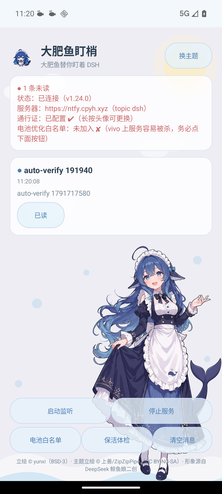
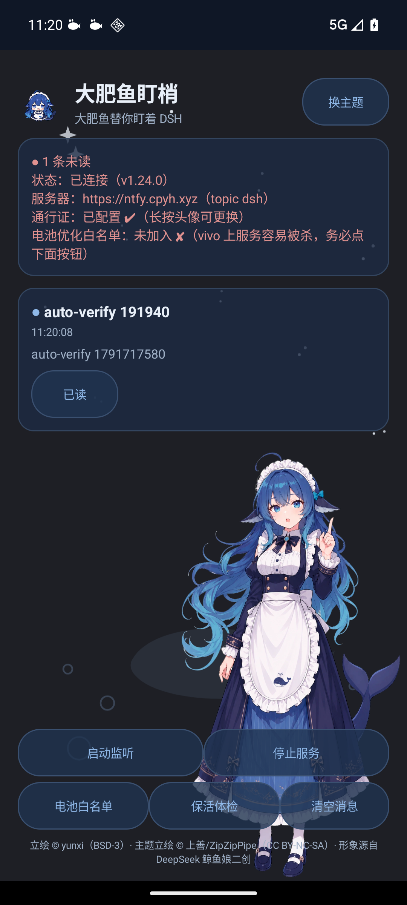
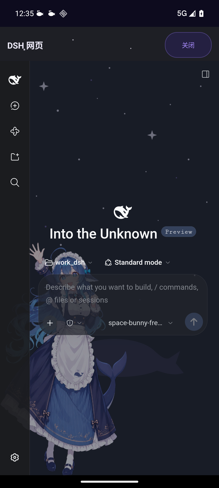
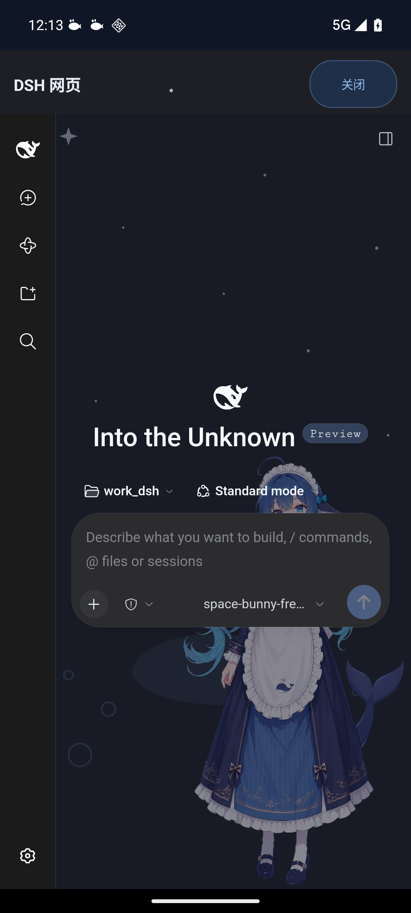

# dsh-push

> DSH（DeepSeek Harness）跑长任务，人走了怎么办？—— 一台没有 Google 推送的国产手机，也能收到任务完成通知、在通知栏直接回答 DSH 的提问。
>
> A self-hosted push bridge between [DeepSeek Harness](https://deepseek.com) (DSH) and Android: task-complete notifications, native quick-answers from the notification shade, and a themed in-app browser for DSH Web — no Google Play Services required.

## 🤖 这个仓库是写给 AI 看的

本项目按 **"AI agent 能自己读完并部署"** 的标准组织文档：把仓库丢给你的 AI 助手（DSH / Claude Code / Codex 等），说一句"帮我把这套推送部署起来"，它应该能自己读文档完成全部工作——起 ntfy 服务器、装 APP、配 DSH hook、跑验收流水线。为此仓库里备齐了：

- `deploy/README.md`：每个服务端脚本的部署位置、凭据文件、下发命令（命令级，可直接执行）
- `verify/README.md`：**AI 作业手册**——一键验收流水线 + 几十条"踩过坑换来的硬事实"（PowerShell 5.1 陷阱、Android 16 行为、模拟器生命周期……），就是给 agent 的避坑清单
- `openspec/`：规格驱动开发全记录（基线规格 + 每个变更的提案/设计/任务），AI 改功能前先读这里
- `verify/config.example.ps1`：所有环境相关值的模板，部署方只需填这一个文件

人类照做当然也行——只是文档的颗粒度是按"执行者没有常识、只会照做和验证"来写的。😉

## 截图

| 主界面 · 日间晴海 | 主界面 · 深夜深海 | 浏览器 · 星空玻璃 | 浏览器 · 深夜玻璃 |
|---|---|---|---|
|  |  |  |  |

六套主题（日间/深夜/樱花/抹茶/星空/焦糖），每套独立场景壁纸 + 全身立绘；应用内浏览器把 DSH Web 整个玻璃化，壁纸从界面后透出。

## 它解决什么问题

- **DSH Web 跑长任务**，人离开电脑后只能反复刷新网页；任务中途 `ask_user_question` 提问会**阻塞等待**。
- 目标手机是 **iQOO 13（Android 16，无 GMS，vivo 后台管控严）**——FCM 系推送全部不可用，通用推送 App 也做不到"通知栏原生渲染问题 + 一键作答、任务当场继续"。

## 架构

```
DSH (hooks.json: Stop / PreToolUse)
  └─ deploy/{work|windows}/dsh-ntfy-push ──POST──▶ ntfy 服务器（自建，TLS）
                                                     │  WebSocket 长连接
                                                     ▼
                              安卓 APP（前台服务 + 开机自启 + 断线重连）
                              ├─ 通知渲染（正文/问题/进度）
                              ├─ 通知栏一键作答 ──▶ 公网作答页(relay) ──tailscale──▶ 应答桥 ──▶ DSH $events → 任务继续
                              └─ 「打开 DSH」内置浏览器（主题壁纸 + 全界面玻璃化）
```

- 推送通道：[ntfy](https://ntfy.sh) 自建实例（`deploy/aliyun/edge-http.conf` 是边缘 nginx 反代配置）
- 作答回桥：`deploy/aliyun/answer-relay.py`（公网 H5/App 双通道）+ `deploy/work/dsh-answer-bridge.mjs`（DSH 侧）
- 全部凭据走外部文件，不入库（见 `deploy/README.md`）

## APP 功能一览（v1.33.34）

- 推送接收：前台服务 + `BOOT_COMPLETED` 自启（Android 16 适配）+ WS 断线自动重连
- 通知即答：问题在通知栏原生渲染（单选/多选/自填），提交后 DSH 任务当场继续；应用内快答浮窗 + ComfyUI 生成的六套立绘成功动画（透明背景 webp）
- 内置浏览器：打开 DSH Web；主题壁纸 + 立绘 + 全界面毛玻璃（注入式，不改 DSH 本体）；文件上传/APK 下载直装
- 手机屏利用：原生顶栏瘦身 + 下滑收起/上滑唤回（Quick Return，带无内容页看门狗自动复位）；网页侧栏收起为**可拖动悬浮鲸鱼钮**（边缘吸附、半隐入边框、位置持久化）
- 六套小清新主题：矢量场景 + 立绘构图（52% 屏高、跨分辨率一致）、按钮半透明、深色主题网页自动暗化
- 杂项：崩溃自报告、未读角标、已读回执、密度/DPI 切换自适应

## 构建

```bash
cd android-app
./gradlew assembleDebug        # JDK 17 + Android SDK 34（AGP 自动下载依赖）
# 产物 app/build/outputs/apk/debug/app-debug.apk（debug 签名，自用即可）
```

APP 开箱即用：安装 → 填 ntfy 服务器地址 + 读令牌 + topic → 订阅。

## 仓库结构

| 目录 | 内容 |
|---|---|
| `android-app/` | 安卓 APP 源码（Kotlin，无第三方 UI 库，~10 个文件）+ 素材源文件与授权 |
| `deploy/` | 服务端脚本权威副本：ntfy 推送钩子、作答 relay/桥、边缘 nginx（见其 README） |
| `host-plugin/` | **DSH 宿主插件（进程内）**：`userQuestions` seam 推通知 + relay 队列回收手机作答，替代"外部通知器 + 外部作答桥"（见其 README） |
| `verify/` | 一键验收流水线（编译→装机→推送断言→截图）+ AI 作业手册 `verify/README.md`；本机配置放 `verify/config.local.ps1`（模板见 `config.example.ps1`） |
| `openspec/` | 规格驱动开发记录：基线规格 + 全部已归档变更提案 |
| `docs/` | 截图与开发日志 |

## AI 开发工作流硬事实（踩过的坑，别再踩）

1. **openspec 归档**：`MODIFIED` 块会**整块替换**基线里的同名需求，所以必须把该需求在基线里的
   **全部既有场景原样带上**（改标题也算删除）。自检：基线里该需求的每个 `#### Scenario:` 标题
   都要在 delta 里出现，否则 `openspec archive` 直接拒绝并点名漏了哪个。
2. **发布一条命令**：`verify/dsh-app-verify.ps1 -Deploy -DeployNote "更新说明"` —— 自动构建、
   装机验收、上架 aliyun 下载链接、**并推更新通知**（带 App 内下载按钮 + 点通知直达下载）。
   只想静默上架加 `-NoNotify`。版本号**只有一处真值**：`android-app/app/build.gradle.kts` 的
   `versionCode` + `versionName` 两个字段一起 bump。App 内显示的版本自 v1.32.17 起**运行时**从
   `PackageInfo.versionName` 派生（`PushService.APP_VER` 那个编译期常量已删——它曾让状态卡片
   显示旧版本号），所以不存在「第三处要同步」，也不会再对不上。
3. **ntfy 推送格式**：要带 title/优先级/click 的 **JSON body 必须 POST 到根路径**
   `https://ntfy.cpyh.xyz` 并把 `topic` 写进 body；POST 到 `/dsh` 会把整坨 JSON 当正文存
   （阿里云边缘 nginx 的解析差异，实测）。纯文本 + `X-Title`/`X-Priority` 头则照常走 `/dsh`。
4. **Windows 脚本编码**：`verify/*.ps1` 刻意保持纯 ASCII（PowerShell 5.1 会把无 BOM 的 UTF-8
   当 ANSI 读，中文变乱码进而炸引号）；确需中文的脚本**必须带 UTF-8 BOM**。
5. **双胞胎主机**：验收机（跑 DSH 与流水线）与模拟器宿主是**两台同名同用户的 Windows**
   （台式机 vs 笔记本）。`verify/config.local.ps1` 里的 `$EmuIp` 指向模拟器宿主；ssh 现场取证
   时先单独 `echo %COMPUTERNAME%` 确认是哪台。
6. **外部 exe 写不进工作区**：这台 Windows 上 python/ffmpeg 等外部进程被 AppContainer 限制，
   对 F: 工作区**只读**（NTFS ACL 本身没问题，`icacls` 查不出来）；产物一律写到
   `%LOCALAPPDATA%\Temp` 再由 PowerShell `Copy-Item` 拷进仓库。素材生成走
   `tools/gen_pose_anim.py --out <Temp>` 就是这个原因。
7. **成功页动画取证姿势**：模拟器上 `screenrecord` 只出 1 帧（废）、`exec-out screencap`
   单次 ~1.5-2s——2.6s 的动画窗口根本抢不到。用 QA 钩子 `am start -n xyz.cpyh.dshpush/.SuccessPoseActivity
   --ei holdMs 9000` 延长停留后连拍三张，再 diff 立绘区（发梢/裙摆动、头不动 = 动画在播）。
8. **手机作答（`host-plugin/`）依赖 `tool-ask-user` 的 timed 模式**：`ctx.userQuestions.answer()`
   只认投影里 `state=continued` 的问题，而只有 `wait.timed === true`（`mode: timed`）的问题才会
   被 fold。三个 profile 现状都是默认 `mode: legacy` → 插件只能推通知、作答落地不了。
   另两条实测坑（宿主 fetch 会把同一 URL 的响应喂回第一次的、投影 state 是
   `{questions:{active,settled}}` 嵌套结构）写在 `host-plugin/README.md`，改轮询代码前先读。
9. **浏览器注入段（`WebActivity.kt` 的 `evaluateJavascript` 长串）三条铁律**：
   ① 新增代码**必须合并成 ≤2 个长字符串字面量**——那条 `"…"+"…"` 拼接链已两次把 Kotlin 编译器
   栈炸穿（psi2ir `generateBinaryExpression` 无限递归、Internal compiler error），拆分操作数=加链深=炸。
   ② 改完必跑语法闸：`node verify/extract-injected-js.mjs > 临时.js && node --check 临时.js`。
   ③ 滚动驱动的原生 UI（顶栏收起/悬浮钮）**必须用真 touch 事件验收**——程序化 `scrollTop`
   步进复现不出「布局回声」（栏切换改 WebView 高度，聊天页钉底补偿产生 ~490ms 的孤立单跳自振，
   用户看到的是果冻）。回归模板：`verify/jelly-test.mjs`、`verify/qr-bar-test.mjs`、
   `verify/newchat-test.mjs`、`verify/fab-drag-test.mjs`（CDP 连 WebView，adb 路径见 `config.local.ps1`）。

## 素材授权
代码为 **MIT**（见 [LICENSE](LICENSE)）。角色立绘为第三方二创，**CC BY-NC-SA 4.0（非商用）**，署名表见 `android-app/assets-src/galgame/NOTICE.md`；商用请替换立绘素材。

## 免责声明

本项目是个人自研工具，非 DeepSeek 官方产品；按"现状"开源，无维护承诺。
